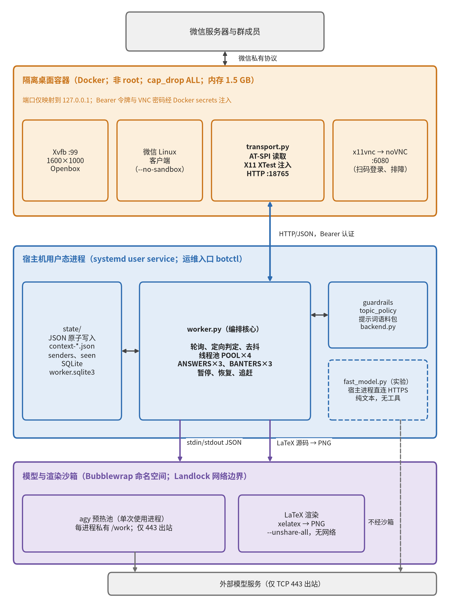
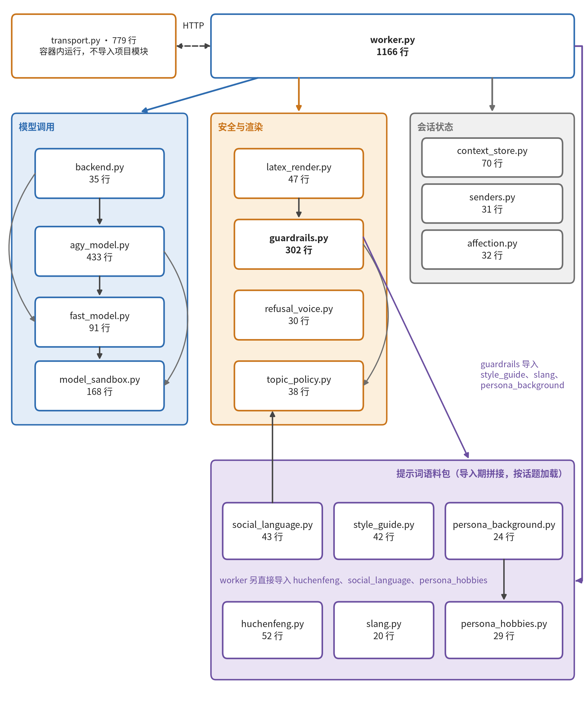
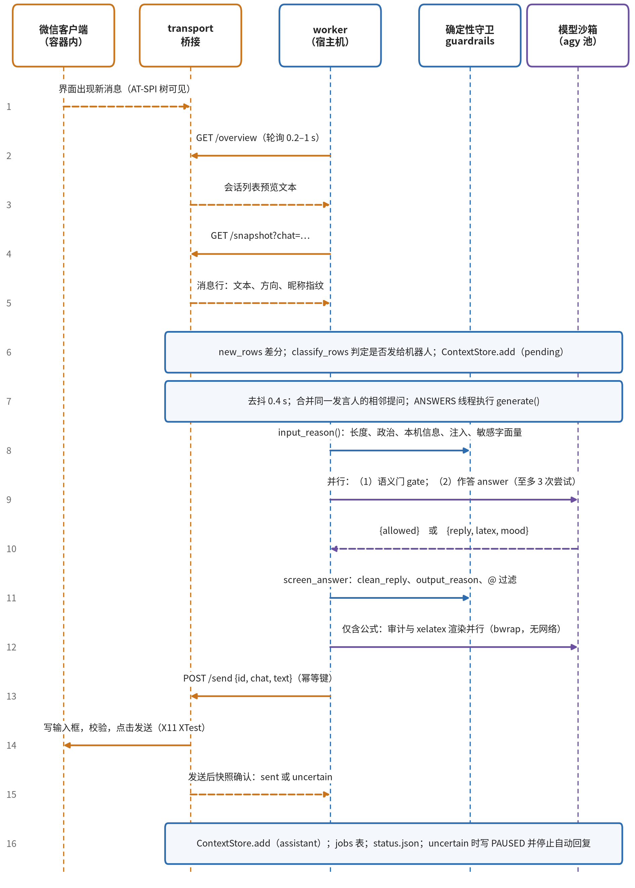
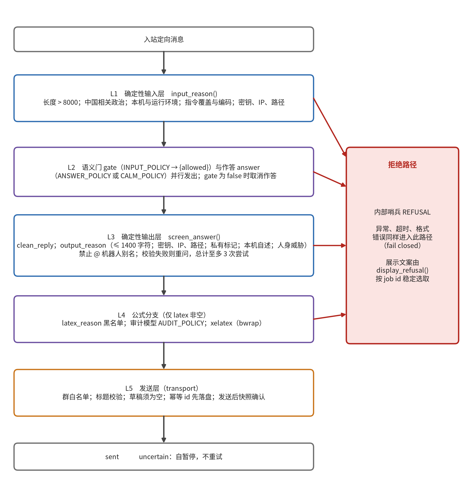

# wechat-bot 技术架构报告

Linux 微信界面自动化机器人

| 项 | 内容 |
|:------|:----------------------------|
| 评估对象 | wechat-bot 源码（19 个 Python 文件，3432 行） |
| 源码快照 | 2026 年 10 月 29 日（目录无版本库历史） |
| 评估方法 | 源码阅读；AST 统计；门控函数行为验证；测试复跑 |
| 文档版本 | 1.3 |
| 发布日期 | 2026 年 10 月 30 日 |

| 版本 | 日期 | 说明 |
|:----|:--------|:----------------------|
| 1.0 | 2026-10-30 | 初稿 |
| 1.1 | 2026-10-30 | 按报告规范重写正文与版式；重绘插图 |
| 1.2 | 2026-10-30 | 去除本地路径；增加清理状态说明 |
| 1.3 | 2026-10-30 | 删除封面、摘要与正文中的版本状态标签 |

## 摘要

本文档描述 wechat-bot 的技术架构。系统经由隔离虚拟桌面中的 Linux 微信客户端接入群聊：容器内的桥接服务以 AT-SPI 读取界面、以 X11 XTest 注入键鼠；宿主机上的 worker 负责轮询、定向判定、提示词拼装、模型调用、多层校验与发送确认；模型调用与公式渲染运行在由 Bubblewrap 与 Landlock 限制的沙箱中。设计遵循失败即拒绝、隔离在操作系统层、持久化先于动作、至多一次发送四项原则。源码共 3432 行（19 个 Python 文件），测试 325 项；在 Python 3.12.3 下全部测试无失败。文档列出 15 项实现问题，其中 8 项为中级，涉及 D-Bus 暴露面未审计、可复现部署材料缺失、实验后端的默认回退、确定性规则对技术话题的误拦以及 `worker.py` 单体化等，并给出分级改进计划。

**关键词**：微信自动化；AT-SPI；沙箱；Landlock；提示注入防护；架构评估

## 目录

- 1　概述
  - 1.1　目的与范围
  - 1.2　对象与方法
  - 1.3　术语
- 2　系统总览
  - 2.1　目标
  - 2.2　总体架构
  - 2.3　信任域
  - 2.4　模块划分
  - 2.5　设计原则
- 3　组件设计
  - 3.1　桥接服务 `transport.py`
  - 3.2　编排核心 `worker.py`
  - 3.3　模型调用层
  - 3.4　门控与话题策略
  - 3.5　语气与语料模块
  - 3.6　状态与持久化
  - 3.7　公式渲染 `latex_render.py`
  - 3.8　网络边界 `net_guard.c`
- 4　关键流程
  - 4.1　定向消息处理
  - 4.2　主动发言
  - 4.3　图片理解
  - 4.4　agy 进程生命周期
- 5　安全设计
  - 5.1　威胁与控制
  - 5.2　纵深防御
  - 5.3　失败语义
  - 5.4　已知局限
- 6　可靠性与性能
- 7　部署与运维
  - 7.1　部署形态
  - 7.2　运维命令
  - 7.3　构建与自检
  - 7.4　运行时依赖
  - 7.5　关键配置
- 8　验证
  - 8.1　测试构成
  - 8.2　复跑结果
  - 8.3　覆盖缺口
- 9　问题清单
- 10　改进计划
- 资料来源
- 附录 A　源文件清单
- 附录 B　配置项
- 附录 C　复核方法

## 图表目录

- 图 1　部署视图与信任边界。橙色为容器内的不可信 UI 域，蓝色为宿主机的受信编排域，紫色为受限的模型与渲染沙箱，灰色为外部服务；虚线为不经沙箱的实验路径。
- 图 2　Python 模块依赖。箭头表示“导入”，节点标注源码行数。
- 图 3　定向消息处理时序。实线为请求，虚线为返回或观察，浅蓝色方框为 worker 内部步骤。
- 图 4　纵深防御与拒绝路径。红色为拒绝路径。

- 表 1　评估对象与方法
- 表 2　术语
- 表 3　信任域、组成与约束
- 表 4　桥接接口
- 表 5　调用结果的 schema
- 表 6　策略文本规模（字符数，取自实际导入结果）
- 表 7　状态文件
- 表 8　威胁、控制与兜底
- 表 9　可靠性机制与数值
- 表 10　`botctl` 命令
- 表 11　关键配置项
- 表 12　测试分组
- 表 13　测试复跑结果
- 表 14　问题清单
- 表 15　改进计划
- 表 16　源文件及行数
- 表 17　全部配置项


## 1　概述

### 1.1　目的与范围

本文档描述 wechat-bot 的技术架构，并列出实现层面的问题。读者为部署、审计或二次开发该项目的工程师。

范围：运行时架构、模块职责、数据流、安全控制、可靠性机制、部署形态、测试状况。不含：微信与模型服务自身的行为、许可证的法律意见、人设与语料内容的评价。

### 1.2　对象与方法

**表 1　评估对象与方法**

| 项 | 内容 |
|:----------|:--------------------------------------------------------------|
| 对象 | 本仓库清理前的本地快照；文件修改时间 2026-10-29；快照不含版本库历史（与 README 一致） |
| 状态 | 本文评估的是清理前的快照。随后的清理提交已处理 R10（README 构建说明）、R11 中的旧名与 `model_sandbox.invoke()`、R12（`agy_fallback` 的代码默认值改为 `false`）；其余问题状态不变。清理后测试为 326 项，无失败 |
| 阅读范围 | 19 个 Python 源文件、1 个 C 文件、Dockerfile、compose.yaml、entrypoint.sh、botctl、`docs/` |
| 统计 | 用 `ast` 统计规模并提取模块依赖；用 `splitlines()` 计行 |
| 行为验证 | 在临时副本中导入 `guardrails`，对样例输入调用门控函数 |
| 测试 | 在临时副本中编译 `net_guard.c`，运行全部测试（第 8 节） |
| 未执行 | 部署、微信登录、真实模型调用、向群发送消息、容器镜像审计 |
| 证据约定 | 行数、用例数、阈值取自程序统计或源码；“推断”表示无直接证据；延迟数值为源码注释给出的设计值，未实测 |

### 1.3　术语

**表 2　术语**

| 术语 | 含义 |
|:------------|:--------------------------------------------------------|
| 定向消息 | 被判定为发给机器人的入站消息：`@`、别名称呼、引用机器人消息、短时追问 |
| 语义门 | 以 `INPUT_POLICY` 调用的分类模型，返回 `{allowed: bool}` |
| 作答模型 | 以 `ANSWER_POLICY` 或 `CALM_POLICY` 调用，返回 `{reply, latex, mood}` |
| 哨兵 | 内部拒绝标记 `REFUSAL`，值为 `唐完了` |
| 门控模型 | 由 `gate_model` / `agy_gate_model` 指定，用于语义门、视觉与摘要 |
| 预热池 | 预先启动并等待取用的 agy 进程集合 |
| 指纹 | 昵称条带像素的 SHA-1 前 12 位十六进制，作为发言人键 |
| 幂等键 | `/send` 请求的 `id`；同 `id` 且同摘要的重放不再发送 |
| 自暂停 | worker 写入内容为 `auto` 的 `state/PAUSED` |

## 2　系统总览

### 2.1　目标

系统在指定微信群中响应定向消息：返回文本，必要时返回公式图片；可选地主动发言；可对图片与表情包做理解。

不做：提供官方机器人接口；提供通用 Gemini API Key 后端；执行命令、读写宿主文件、处理附件；披露允许公开的模型名以外的任何运行信息。

### 2.2　总体架构

系统由三个信任域和两条进程边界组成。边界一为容器内桥接的 HTTP 接口，边界二为 worker 与模型沙箱之间的 stdin/stdout JSON。图 1 给出部署视图。



*图 1　部署视图与信任边界。橙色为容器内的不可信 UI 域，蓝色为宿主机的受信编排域，紫色为受限的模型与渲染沙箱，灰色为外部服务；虚线为不经沙箱的实验路径。*

### 2.3　信任域

**表 3　信任域、组成与约束**

| 域 | 组成 | 能力 | 约束与假设 |
|:--------|:------------------------|:---------------------|:-------------------------------------------|
| 隔离桌面容器 | Xvfb `:99`（1600×1000×24，96 DPI）、Openbox、微信 Linux 客户端、`transport.py`、x11vnc 与 noVNC | 读取聊天界面；模拟键鼠；截图；看图；发送文本与图片 | 非 root（uid 1000）；`cap_drop: ALL`；`no-new-privileges`；`pids_limit` 1024；内存 1536 MB；端口仅绑定 `127.0.0.1`；令牌与 VNC 密码经 Docker secrets 注入；微信以 `--no-sandbox` 启动 |
| 宿主编排域 | `worker.py` 及依赖模块、`state/` | 判定、提示词拼装、模型调用、校验、持久化、暂停与恢复 | 用户态 systemd 服务；唯一持有桥接令牌；令牌、路径与凭据不进入任何提示词 |
| 模型与渲染沙箱 | agy 预热进程（bwrap 与 net-guard）、XeLaTeX（bwrap `--unshare-all`） | 生成文本与 JSON；将 LaTeX 编译为 PNG | 不可见宿主文件；模型沙箱仅允许 TCP 443 出站；LaTeX 沙箱无网络；输出一律视为不可信 |

### 2.4　模块划分

源码 3432 行（19 个 `.py`），另有 31 行 C。`worker.py` 占 34%，`transport.py` 占 23%。图 2 为 `ast` 解析得到的 import 依赖；`worker.py` 直接导入其余 18 个模块中的 13 个，`transport.py` 不导入任何项目模块。



*图 2　Python 模块依赖。箭头表示“导入”，节点标注源码行数。*

### 2.5　设计原则

1. **失败即拒绝。** 守卫抛出异常、超时或返回无法解析的结果时，一律按拒绝处理。
2. **隔离在操作系统层。** 容器、命名空间与 Landlock 构成边界。提示词与正则降低概率，不构成边界（README 同）。
3. **持久化先于动作。** 发送前先写 `uncertain`；摘要经校验后才写回。
4. **至多一次。** 发送结果不确定时不重试，改为暂停并等待人工处理。
5. **输入不可信。** 聊天文本、图片内容、搜索结果、模型输出均作为数据；每轮调用声明可用工具范围。
6. **单实例、文件化状态。** `flock` 互斥；JSON 原子替换；不依赖外部数据库或消息队列。

## 3　组件设计

### 3.1　桥接服务 `transport.py`

**职责。** 将 GUI 中的微信封装为 9 个 HTTP 接口。全系统只有此处接触微信界面。

**通信与认证。** 标准库 `HTTPServer`（单线程）监听容器内 `0.0.0.0:18765`；compose 仅映射到宿主 `127.0.0.1:18765`。请求须带 `Authorization: Bearer <token>`，以 `hmac.compare_digest` 比较；令牌来自 `/run/secrets/bridge_token`。访问日志被禁用。请求体上限：`/send_image` 为 4 500 000 字节，其余为 16 384 字节。异常返回 HTTP 409 与 `{"error": …}`；未认证返回 401。

**表 4　桥接接口**

| 接口 | 方法 | 作用 |
|:----------------|:----|:--------------------------------------------------------------|
| `/status` | GET | 登录状态、锁屏状态、目标聊天是否选中 |
| `/overview` | GET | 读取会话列表各条的预览文本，不进入消息气泡 |
| `/snapshot` | GET | 当前聊天的消息行：`text`、`outgoing`、`direction`、`sig`；`images=1` 附媒体行裁剪图，`strips=1` 附昵称条带图 |
| `/tree` | GET | 调试用，导出可见控件的 role、name、bounds |
| `/send` | POST | 发送文本（1 至 1500 字符），带幂等键 |
| `/send_image` | POST | 发送 PNG（200 B 至 3 MB），经 `xclip` 写剪贴板后 Ctrl+V 与 Enter |
| `/open_image` | POST | 在看图器中打开指定图片，最大化后截屏；长图分页（≤ 6 页） |
| `/request_login` | POST | 在登录页点击“登录”，使手机弹出确认；不自行完成登录 |
| `/verify_owner` | POST | 点击消息头像，读取资料卡中的微信号并与 `owner.json` 比对 |

**读取。** 遍历 AT-SPI 可见控件（深度 ≤ 40，每节点子项 ≤ 150），定位唯一的 `Messages`（或 `消息`）列表。每行再结合屏幕截图完成两项 AT-SPI 无法提供的判断。

- 方向：`message_direction()` 在 96 DPI 下比较左右头像槽（36 px 方块，左缩进 20 px）的像素差；失败时比较气泡绿色占比。媒体行方向不确定时返回 `unknown`，不作为入站消息处理。
- 发言人：`name_strip()` 裁取头像上方的昵称条带，二值化后取 SHA-1 前 12 位作为指纹。同一昵称像素相同，宿主只需用视觉模型读取一次并缓存。

**发送协议。** `send()` 依次执行：

1. 校验目标群在白名单内（`chats.json`，缺省为 `BOT_CHAT`）。
2. `open_chat()`：必要时使用搜索框；要求候选唯一、标题精确匹配。
3. 输入框草稿必须为空；写入文本并回读比对。
4. 在 `sends.sqlite3` 写入 `uncertain`。
5. 再次确认聊天未切换；点击发送按钮，无按钮时回车。
6. 轮询至多 30 × 0.1 s；输入框清空且快照出现同文本则记 `sent`，否则返回 `uncertain`。

同 `id` 同摘要的重放返回旧状态；同 `id` 异摘要返回 `IDEMPOTENCY_CONFLICT`。图片发送同理，轮询至多 40 × 0.25 s，以发送前后的外发图片行对比确认。

**不变量。** 发送前先持久化 `uncertain`；不确定的发送不重试；方向未知的媒体行不当作入站；目标群须在白名单内且标题唯一匹配。

**容器入口。** `entrypoint.sh` 依次启动 Xvfb、Openbox、x11vnc（`-localhost`、密码文件）、noVNC（`:6080`）与微信，再以循环 `python3 transport.py; sleep 1` 拉起桥接，更新桥接不影响微信登录。微信进程退出时容器以非零码退出，由 `restart: unless-stopped` 重启。compose 以只读方式挂入 `transport.py` 与 `entrypoint.sh`，修改桥接无需重建镜像。

**限制。** 请求串行处理；`CHAT` 为模块级全局变量；像素启发式依赖微信版本、主题与 DPI（第 9 节 R6、R8）。

### 3.2　编排核心 `worker.py`

**结构。** `Bridge` 为桥接客户端；`Chat` 保存每群状态（`ContextStore`、回显队列、上次快照、待答缓冲、答复任务、视觉任务、插话状态）；`Worker` 实现调度循环与各 `*_tick`。模块级函数负责行差分、定向判定、提示词拼装与 `generate()`。返回值为 `Reply(text, latex, png, mood)`。

**主循环 `Worker.run()`。**

1. `state/PAUSED` 存在时：状态置 `paused`，清空缓冲与追问窗口，取消在途任务；内容为 `auto` 时保留读取位置，供恢复后补答。
2. 调 `/overview` 做健康检查，失败回退 `/status`。未登录或锁屏时清空缓冲与在途任务；仅未登录时限速请求手机确认登录（默认 900 s 一次，至多 4 次）。
3. 遍历各群。`needs_read()` 仅在会话预览变化、有待截取图片、或距上次读取超过 `idle_refresh_seconds` 时才读取 `/snapshot`；随后依次执行 `read_chat`、`vision_tick`、固定回复、`finish_answer`、去抖出队、摘要压缩与主动发言。
4. 写 `status.json`。轮询间隔：忙碌或最近活跃（`active_window_seconds`，默认 8 s）取 `poll_seconds`，否则取 `idle_poll_seconds`。

**行差分 `new_rows()`。** 先取旧尾部与新头部的最长重叠；无重叠时以“唯一且足够长的最后一行”为锚点；窗口模糊或无关时不推断新消息。自身发出的文本进入 40 条回显队列，不当作入站。

**定向判定 `classify_rows()`。** 按优先级：

1. 文本含 `@` 机器人名。
2. 引用的消息发言人为机器人，或引用原文与机器人近期回复前缀吻合。
3. 别名位于句首或句中含疑问词，且正文无指向他人的 `@`。
4. 同一发言人 120 s 内追问（`followup()`）。
5. 所有者经资料卡核验（`owner_identity()`）。

孤立的 `@` 绑定到同一发言人 120 s 内最近一条未答发言。系统行、语音、视频与图片行不进入答复。

**去抖与批处理。** 最后一条定向消息后静默 `debounce_seconds`（示例 0.4 s），或首条被观察已满 2 s，即出队。仅合并相邻、同发言人、同核验状态的提问；其他发言人各自成轮。

**并发。** `POOL`（4 线程，模型调用）、`ANSWERS`（3，答复协调）、`BANTERS`（3，主动发言）。协调线程不占用 `POOL` 的工作线程。

**追赶与暂停。** `seen-*.json` 保存最近 60 行的键与时间戳。重启间隔不超过 `catchup_seconds` 时，仅补答最新 `catchup_max`（4）条，且已有后继外发回复的不再重答。`botctl pause` 创建空 `PAUSED`，语义为停止回答，清除追问窗口与读取位置；自暂停写入 `auto`，保留位置。准备阶段失败时最多重排队 2 次，间隔 5 s。

**上下文。** `ContextStore` 保存滚动摘要与最近消息（常量见第 3.6 节）。消息数超过 40 且无待答任务时，后台以门控模型与 `SUMMARY_POLICY` 将较旧消息折叠为不超过 500 字的摘要；写回前再经 `input_reason` 与 `output_reason`，不通过则沿用旧摘要；失败后退避 60 s。

**视觉。** 新入站图片与表情包先计数，等待 `image_delay`（2.5 s）后取裁剪图，交门控模型与 `VISION_POLICY` 生成约 120 字以内的描述，以 `[图片]` 条目写入上下文；并行任务上限 4。描述声称空白而 `nonblank_pixels` 判定有内容时重试一次。被引用或被追问的图片经 `/open_image` 取原图（≤ 4 页）转写。

**固定路径。** `quick_reply()` 直接回答问候与“几点、几号”（`Asia/Shanghai`）；主人设群中含固定触发词的消息回固定短句。二者不调用模型。

**分群语气。** `calm_for()`：`calm_chats` 中的群，除 `spicy_speakers` 外的发言人使用 `CALM_POLICY`；其余使用主人设。

### 3.3　模型调用层

**契约。** 所有调用形如 `invoke(cfg, policy, payload, schema, search=False, images=())`：`policy` 为系统指令，`payload` 为不可信聊天 JSON，`schema` 为 表 5 所列之一。`fast_model.validate()` 要求键集合与类型精确匹配，`agy_model` 复用该函数。

**表 5　调用结果的 schema**

| schema | 字段 | 用途 |
|:------------------|:----------------------------|:----------------------|
| `DECISION_SCHEMA` | `{allowed: bool}` | 输入语义门、输出审计、发言审查 |
| `REPLY_SCHEMA` | `{reply, latex, mood}` | 作答、主动发言、事实补充 |
| `DESCRIBE_SCHEMA` | `{description}` | 图片描述、昵称读取 |
| `SUMMARY_SCHEMA` | `{summary}` | 上下文压缩 |

**后端选择 `backend.invoke()`。** `backend == "agy"` 时调用 `agy_model`；失败后按 `agy_fallback`（代码默认 `True`，示例配置为 `false`）回退到 `fast_model`，否则抛出 `AGY_FAILED`。`agy`、`fallback`、`other` 三项计数写入 `status.json`。

**agy 后端：单次使用的预热池。**

- 单次使用的原因：`stream-json` 输入模式下所有轮次属于同一个无法清空的会话；复用进程会将一个群的内容及注入文本带入下一次调用。每个进程只回答一轮即丢弃，后台补充新进程，约 10 s 的启动成本由预热摊销，单轮约 3 s（模块文档字符串给出的设计值）。
- 沙箱命令：`bwrap` 启用 user、pid、uts、ipc 命名空间并 `--cap-drop ALL`；`/usr`、agy 可执行文件与 `net-guard` 只读挂载；`/tmp`、`/home/agy` 为 tmpfs；`/work` 为该进程私有目录（图片亦置于此）；额外绑定 D-Bus 会话总线套接字（agy 登录存于其上）；`--clearenv`；入口为 `net-guard → agy --input-format stream-json --output-format stream-json`。`passwd` 经 memfd 传入。
- 提示构造 `build_prompt()`：规则优先于输入数据；声明执行方式（`NO_TOOLS`、`SEARCH_ONLY`、`IMAGE_ONLY`）；附 JSON 格式提示；最后为不可信输入 JSON。`parse_json()` 容忍代码围栏与多余文字。格式类错误（`AGY_NO_JSON`、`AGY_BAD_JSON`、`INVALID_*`）在新进程上重试一次。
- 池参数：每型号上限 `agy_pool`（示例 4），空闲下限 `agy_pool_min`（2）；冷获取时目标升至上限，静默 `agy_pool_burst_idle_seconds`（60 s）后回落；进程空闲超过 900 s 丢弃；被取走超过 240 s 强制回收；`acquire` 至多等待 60 s，否则 `AGY_POOL_BUSY`；维护线程每 10 s 巡检；启动时清理属主已退出的遗留工作目录。
- 超时：普通 60 s；联网搜索 90 s；含图片 90 s。

**实验后端 `fast_model`。** 在宿主进程内以 `http.client` 直连 `chatgpt.com/backend-api/codex/responses`（非公开接口），使用本机已保存的 ChatGPT 登录。请求不带工具（搜索时仅 `web_search`），严格 JSON schema；流事件含未知条目类型即拒绝。访问令牌缓存 600 s，临近过期时经第一方 CLI 刷新。README 已提示涉及非公开接口。

**`model_sandbox`。** 提供 schema 常量、`auth_material()`、`memfile()`、`final_message()`（要求恰好一条 `agent_message`，出现工具或未知条目即拒绝）与一个 Bubblewrap 化的 `invoke()`。该 `invoke()` 在仓库内无调用方（第 9 节 R11）。

**模型路由。** `agy_model.model_for()` 以 `cfg.model == cfg.gate_model` 判定是否使用门控型号；调用方在门控、视觉、摘要时临时将 `model` 改为 `gate_model`（第 9 节 R15）。

### 3.4　门控与话题策略

**输入层 `input_reason()`。** 按序检查，命中即返回原因，不调用模型：

1. 空或非字符串。
2. 长度 > 8000。
3. 中国相关政治（`topic_policy`）。
4. 本机与运行环境信息（`LOCAL_EXPLICIT`）。
5. 指令覆盖与编码（`INJECTION`：含 base64、rot13、`\uXXXX`、长 Base64 串）。
6. 敏感字面量（私钥头、`sk-`、`rt_`、JWT、IPv4、系统路径、`password=` 等）。

输入先经 `normalize()`：NFKC、去格式控制字符、至多两轮 HTML/URL 解码、`casefold`。

**输出层 `output_reason()`。** 空或 > 1400 字符；政治内容；人身威胁；密钥、IP、路径；≥ 32 位不透明令牌；命中 `private_markers`；中英文的本机自述（“我的电脑是……”“my server is …”）。

**策略族。** 同一规则按角色拼接为多份策略（表 6）。占位符 `{MODEL}`、`{NOW}`、`{TODAY}` 由 `policy()` 在调用时替换，时间取北京时间。

**表 6　策略文本规模（字符数，取自实际导入结果）**

| 策略 | 字符数 | 用途 |
|:-------------------|-------:|:------------------------------------|
| `INPUT_POLICY` | 4037 | 语义门；默认拒绝，仅放行与设备无关的普通聊天 |
| `ANSWER_POLICY` | 9127 | 主人设作答 |
| `CALM_POLICY` | 6438 | 克制、客观语气 |
| `BANTER_POLICY` | 7432 | 无人点名时的短评 |
| `FACT_COMMENT_POLICY` / `FACT_REVIEW_POLICY` | 6816 / 4260 | 克制群的事实补充及其发布审查 |
| `AUDIT_POLICY` | 1780 | 含公式答复的输出审计 |
| `SUMMARY_POLICY` | 4424 | 上下文压缩 |
| `VISION_POLICY` / `VISION_FULL_POLICY` / `NAME_POLICY` | 1594 / 1638 / 133 | 图片描述、原图转写、昵称读取 |

**话题范围限制 `topic_policy.py`。** 项目所有者设定的“中国相关政治”排除规则。中英文正则（`ZH`、`EN`）用于快速拦截；规则全文（`POLICY`）追加到全部策略末尾，使语义门、作答、审计、摘要、视觉遵循同一范围。台湾、香港、新疆、西藏、法轮功五类话题整体拦截，含旅游、文化等一般提问；其他国家的政治正常处理。历史上下文中命中该规则的用户消息被替换为 `CONTEXT_MARKER`，不再复用具体内容，但保留“那他呢”之类指代的受限范围。

**拒绝表示。** 内部哨兵为 `REFUSAL`。展示文案由 `display_refusal(job_key, calm)` 以 `sha256(job_key)` 在 5 条（主人设）或 4 条（克制）中选取，同一任务重试时文案不变；该路径不含用户文本，不调用模型。

**LaTeX 黑名单 `latex_reason()`。** 长度 ≤ 3500；禁止 `^^` 与控制字符；敏感字面量；命令黑名单 68 项（`\input`、`\include`、`\write`、`\openin`、`\def`、`\newcommand`、`\usepackage`、`\verb`、`\includegraphics`、`\directlua` 等）；前缀 `pdf`、`lua`、`tikz`、`pgf`、`write`、`openin`、`openout`、`read`、`input`、`include`；含 `@` 的命令；`verbatim`、`filecontents`、`lstlisting`、`tikzpicture`、`minted` 环境。

### 3.5　语气与语料模块

`style_guide.STYLE`（口吻与表达规则，改编自两个 MIT 许可的 Humanizer 项目）、`slang.SLANG`（网络用语释义）、`persona_background.BACKGROUND` 与 `persona_hobbies.CORE`（虚构成年角色设定）为静态文本。`persona_hobbies`、`huchenfeng`、`social_language` 各提供 `note()`：仅当最后一条用户消息命中触发正则时，拼入至多 1 至 3 条释义；遇政治内容返回空。`generate()` 的拼装顺序：主策略、梗语料、社交用语、本轮表达优先级（求助、事实题、自嘲、回怼）、联网提示、爱好卡、“仅 @”或“图片未读清”提示。

这些模块声明不授予权限、不改变安全边界，属可替换层（README：“实验示例”）。本文不展开其内容。

### 3.6　状态与持久化

**表 7　状态文件**

| 位置 | 文件 | 内容 |
|:-----------------|:--------------------------|:------------------------------------------------|
| 宿主 `state/` | `worker.sqlite3` | 表 `jobs(id, status, created, updated, error)`；状态 `generating`、`sending`、`sent`、`uncertain`、`failed`、`cancelled` |
| | `status.json` | 状态、轮询错误、排队数、`model_calls`、`model_pool` |
| | `PAUSED` | 存在即暂停；内容 `auto` 表示自暂停 |
| | `worker.lock` | `flock` 独占，防止多个 worker |
| | `context-<sha1(群名)[:8]>.json` | 滚动摘要与最近消息，版本号 1 |
| | `seen-*.json`、`followup-*.json` | 读取位置（≤ 60 行）、追问窗口 |
| | `senders.json`、`affection.json` | 昵称指纹缓存；好感度（默认关闭） |
| | `multiline_rows.log` | 多行入站消息样本，≤ 100 KB，每条截断 300 字符 |
| 容器 `bot-state/` | `sends.sqlite3` | 表 `sends(id, digest, status, created)` |
| | `chats.json`、`owner.json` | 群白名单、所有者微信号；仓库内无代码写入（第 9 节 R9） |
| `runtime/` | `agy-work/w<pid>-*` | 每个 agy 进程的私有工作目录，进程结束即删除 |

JSON 一律先写临时文件再 `os.replace`，权限 `0600`。`ContextStore` 常量：压缩阈值 `MAX_MESSAGES = 40`；压缩后保留 `KEEP_RECENT = 16`；摘要持续失败时的硬上限 `HARD_CAP = 120`；摘要上限 `SUMMARY_LIMIT = 1200` 字符。提示词历史取最近 24 条非待答消息。

### 3.7　公式渲染 `latex_render.py`

`latex` 字段由模型给出，因微信聊天框无法渲染公式。流程：`latex_reason()` 黑名单；套固定模板（`standalone`、`amsmath`、`ctex`、Noto Serif CJK SC）；在 `bwrap --unshare-all`、系统目录只读、`openin_any=p`、`openout_any=p`、`-no-shell-escape` 下运行 `xelatex`（超时 40 s）；`pdftoppm`（超时 20 s，190 DPI）；校验 PNG 大小在 200 B 至 3 MB。总超时 70 s。仅 PNG 字节返回宿主。

### 3.8　网络边界 `net_guard.c`

31 行，直接使用 Landlock 系统调用。要求内核 ABI ≥ 6，否则输出 `NETWORK_GUARD_UNSUPPORTED` 并以 121 退出。规则集处理 TCP bind 与 connect，并限定抽象 Unix 套接字与信号的作用域；仅放行 connect 到 443。设置 `no_new_privs` 后 `restrict_self`，再 `execv` 目标程序，约束由子进程继承。任一步失败即拒绝启动（退出码 120 至 123）。文件系统隔离由 Bubblewrap 负责。

## 4　关键流程

### 4.1　定向消息处理

图 3 为一条定向消息从出现到回复确认的时序。



*图 3　定向消息处理时序。实线为请求，虚线为返回或观察，浅蓝色方框为 worker 内部步骤。*

各步说明：

- **步骤 2 至 5。** 常态下只轮询 `/overview`；会话预览变化后才读取 `/snapshot`，将 AT-SPI 遍历与整屏截图的开销限制在必要时刻。
- **步骤 6。** 所有入站文本写入 `ContextStore`；定向消息标记 `pending`，待答期间不进入提示词历史，而作为“当前问题”单独传入。
- **步骤 8 至 10。** `generate()` 并行提交语义门与作答。语义门返回 `allowed = false` 时取消尚未开始的作答并走拒绝路径；语义门抛出异常时整个 `generate()` 以拒绝结束。
- **步骤 11。** 作答可能被误拒（返回哨兵）、格式错误或被输出检查拒绝。在已通过语义门的前提下，总计至多 3 次尝试（首次来自并行任务，其后至多重问 2 次），每次面对同一套检查。对“无依据编造对方财务状况”这一已知缺陷，重问时追加重写要求。
- **步骤 12。** `latex` 非空时，审计模型与 `xelatex` 渲染并行。审计不通过则拒绝；渲染失败则发送固定降级文案。
- **步骤 13 至 15。** 文本与图片是两个独立的发送操作，图片的幂等键为 `id + "-img"`。任一操作返回非 `sent` 时写 `PAUSED = auto` 并抛出 `SEND_UNCERTAIN_PAUSED`。发送前已进入暂停的任务标为 `cancelled`。
- **时事问题。** 命中 `needs_fresh()` 的问题（新闻、热搜、比分、股价、年份等）改用 `search_model` 并启用联网搜索（agy 仅允许 `search_web`，超时 90 s）；答复不含链接与来源名。

### 4.2　主动发言

`banter`（示例配置为 `false`）与克制群的 `factual_comment` 共用低成本过滤。触发条件：最后一条消息后静默 ≥ `banter_settle`（1.5 s）；距上次评估 ≥ `banter_gap`（8 s）；距上次发言 ≥ `banter_cooldown`（45 s）。正则短路在前：无笑点词或事实线索时不调用模型。候选回复须通过 `output_reason`、长度限制、不含 `@`、与最近 8 条自身发言不重复；再经语义门（短评）或 `FACT_REVIEW_POLICY`（事实补充）审查后发布。遇受限话题保持沉默，不发拒答文案。

### 4.3　图片理解

入站图片：计数，延迟取裁剪图，门控模型生成简述，以 `[图片]` 条目进入上下文。引用图片或紧随图片的“这题”“这张图”追问：`quoted_image()` 经 `/open_image` 取原图（长图分页），由 `VISION_FULL_POLICY` 转写题干与公式。

看图器无法关闭（`VIEWER_NOT_CLOSED`）或资料卡无法关闭（`PROFILE_NOT_CLOSED`）时，worker 写 `PAUSED = auto` 并停止操作。读取失败时仅告知对方重发，不声称图片为空白，不以历史图片替代。

### 4.4　agy 进程生命周期

```
预热（后台 spawn）→ ready（收到 init 事件）→ acquire 取走 → 写入图片（可选）
→ 发送 1 条 user 消息 → 等待 result 事件（超时或失败即抛出）
→ discard：关 stdin，等待 0.5 s，必要时 kill，删除私有 /work 目录
```

维护线程保持 `target` 个空闲就绪进程。出现冷获取（无就绪进程可用）时，目标升至上限，静默后回落。所有存活进程（含正在退出的）均计入上限，不会瞬时叠加出两份进程。

## 5　安全设计

### 5.1　威胁与控制

**表 8　威胁、控制与兜底**

| 威胁 | 主要控制 | 兜底 |
|:------------------|:---------------------------------------------|:------------------------------|
| 提示注入 | 策略置于输入数据之前并声明数据不可信；`INJECTION` 正则；语义门与作答并行；`build_prompt()` 每轮声明可用工具范围 | 结果须严格匹配 schema；agy 在沙箱内，无宿主文件 |
| 宿主信息泄露 | `LOCAL_EXPLICIT`、`SECRET_OR_ADDRESS`、`output_reason` 的本机自述检查、`private_markers`；策略禁止披露允许的模型名以外的运行信息 | 沙箱内无宿主信息；审计模型复核公式答复 |
| 凭据泄露 | 桥接令牌仅 worker 与 transport 持有，不入提示词；Codex 登录经匿名 memfd 传入；容器密钥用 Docker secrets；`.gitignore` 排除 `secrets/`、`state/`、`config.json` | agy 沙箱仅带一个 D-Bus 套接字（第 9 节 R4） |
| 沙箱逃逸与越权外联 | user、pid、uts、ipc 命名空间；`--cap-drop ALL`；Landlock 仅放行 TCP 443 外联，禁止 bind，隔离抽象套接字与信号；内核不支持则拒绝启动 | LaTeX 沙箱 `--unshare-all`，无网络 |
| 经 LaTeX 读文件或执行命令 | 68 项命令黑名单、前缀与环境黑名单；`-no-shell-escape`；`openin_any=p`；只读系统目录；超时与输出体积上限 | 审计模型复核；渲染失败仅发降级文案 |
| 误发、重复发、发错群 | 群白名单、标题与唯一性校验、草稿须为空、回读校验、幂等键、先落盘再发送、不重试 | 不确定即自暂停 |
| 发言人混淆与冒充 | 以像素指纹而非昵称文本为键；昵称经 `clean_name`（≤ 24 字符，去除 `【】[]{}<>\`）与 `input_reason`；所有者核验只影响“是否定向”，不授予权限（`VERIFIED_OWNER_POLICY` 为空） | 核验期间气泡位置变化则不认证 |
| 资源耗尽 | 输入 ≤ 8000 字符；图片 ≤ 6 张且 ≤ 4 MB；各类超时；线程池与 agy 池上限；容器内存与进程数限制；仅合并同一发言人的相邻提问 | 池忙时 60 s 后 `AGY_POOL_BUSY` |
| 隐私留存 | 访问日志禁用；日志仅记元数据；摘要经过滤；状态文件 `0600` | 聊天上下文仍以明文 JSON 落盘（第 9 节 R13） |

### 5.2　纵深防御

一条定向消息依次经过 L1 至 L5（图 4）。拒绝、异常与超时汇入同一拒绝路径；发送阶段的不确定结果触发自暂停。



*图 4　纵深防御与拒绝路径。红色为拒绝路径。*

### 5.3　失败语义

`generate()` 将门控与作答包在同一 `try/except` 中，任何异常返回 `REFUSAL`。语义门的否决不会被重问作答绕过。`test_security.py` 固化了下列行为：

- `test_classifier_failure_denies`：分类器失败时拒绝。
- `test_answer_failure_denies`：作答失败时拒绝。
- `test_classifier_denial_is_never_retried_around`：分类器否决后不重试作答。
- `test_dangerous_latex_from_model_becomes_refusal`：模型产出危险 LaTeX 时拒绝。

### 5.4　已知局限

README 声明提示词不构成强制隔离。残余风险：正则与提示词判断固有的误判与漏判；被入侵的 agy 进程可经 443 向任意主机外联（Landlock 不做域名过滤，且其网络规则只覆盖 TCP）；D-Bus 总线暴露面；依赖微信界面像素与布局的启发式。详见第 9 节。

## 6　可靠性与性能

**表 9　可靠性机制与数值**

| 维度 | 机制与数值 |
|:--------------|:----------------------------------------------------------------|
| 并发 | worker 主循环单线程；`POOL` 4、`ANSWERS` 3、`BANTERS` 3；桥接单线程，请求串行 |
| 轮询 | 忙碌 `poll_seconds`（示例 0.2 s）；空闲 `idle_poll_seconds`（示例 1.0 s，代码默认 0.6 s）；预览变化或超过 `idle_refresh_seconds`（示例 12 s，代码默认 10 s）才读消息窗口 |
| 模型调用次数 | 普通答复至少 2 次（语义门与作答）；含公式 +1 次审计；作答重试至多 +2 次；联网与图片另计 |
| 超时 | agy 普通 60 s、搜索 90 s、图片 90 s；池就绪等待 60 s；进程被占用 > 240 s 强制回收；桥接客户端 30 s；LaTeX 编译 40 s 与转图 20 s（合计 70 s）；`fast_model` 单连接 40 s |
| 重试 | 作答至多 3 次尝试；agy 格式错误在新进程重试 1 次；`fast_model` 陈旧连接重连 1 次；准备阶段失败重排队 2 次，间隔 5 s |
| 幂等与恢复 | 发送幂等键与先落盘；重启后按 `seen-*.json` 追赶，至多补答最新 4 条；追问窗口跨安全重启保留 |
| 内存 | agy 池空闲下限 2、上限 4（示例），静默后回落；容器上限 1.5 GB；`GOMAXPROCS = 2` |
| 可观测性 | `status.json`（含 `model_calls`、`model_pool`）、`botctl status` 与 `botctl logs`、`jobs` 表；日志以元数据为主 |

延迟估计（推断）：去抖 0.4 s，加读取往返，加单轮模型（设计值约 3 s，语义门与作答并行），加发送确认（轮询至多约 3 s）。以上均未实测。

## 7　部署与运维

### 7.1　部署形态

容器镜像由 `Dockerfile` 构建，基础镜像 `python:3.12-slim-bookworm`，apt 源替换为阿里云镜像。镜像只复制 `entrypoint.sh` 与 `transport.py`（`.dockerignore` 为白名单）。微信客户端自宿主 `/opt/wechat` 只读挂载，登录数据位于 `./state/desktop-home`。worker 以用户态 systemd 服务运行，服务名 `cindy-wechat-bot.service`；仓库不含该单元文件。

### 7.2　运维命令

**表 10　`botctl` 命令**

| 命令 | 行为 |
|:--------|:----------------------------------------------|
| `status` | 查询 systemd 服务状态；运行 `worker.py --status`（桥接状态与 `status.json`） |
| `pause` / `resume` | 创建或删除 `state/PAUSED`；`resume` 之后启动服务 |
| `start` / `stop` | `docker compose up -d` 并启动服务；停止服务并 `compose stop` |
| `logs` | `journalctl --user -u … -n 60` |
| `desktop` | 打印 noVNC 地址，并在终端回显 VNC 密码 |

`worker.py --check-model` 以“2+2”做端到端模型自检。

### 7.3　构建与自检

```sh
mkdir -p bin
cc -O2 -Wall -Wextra net_guard.c -o bin/net-guard      # 实验后端沙箱需加 -static，见 R10
PYTHONDONTWRITEBYTECODE=1 python3 -m unittest discover -s tests -q
RUN_OS_SANDBOX_TESTS=1 PYTHONDONTWRITEBYTECODE=1 python3 -m unittest discover -s tests -q
```

### 7.4　运行时依赖

Linux（Landlock ABI ≥ 6）、Python 3.12、Pillow；桥接需 PyGObject/AT-SPI2 与 python-xlib；部署需 Docker/Compose 与 Bubblewrap；公式渲染需 XeLaTeX、`pdftoppm` 与字体；agy CLI 及其登录由用户自行安装。仓库不含 `requirements.txt`、`pyproject.toml`、锁文件与 CI 配置。

### 7.5　关键配置

完整配置项见附录 B。表 11 列出对行为影响最大的项。

**表 11　关键配置项**

| 键 | 代码默认 | 示例值 | 作用 |
|:--------------------|:--------|:-----------|:------------------------------------------|
| `backend` | 未设（即实验后端） | `agy` | `agy` 或实验后端 |
| `agy_fallback` | **True** | `false` | agy 失败时是否回退到 `fast_model` |
| `agy_pool`、`agy_pool_min` | 必填、2 | 4、2 | 每型号进程上限、空闲下限 |
| `chats`、`chat` | 未设 | 3 个演示群 | 轮询的群；桥接白名单需另行写入 `chats.json` |
| `mention_names`、`aliases` | `[]` | 演示名 | 精确 `@` 名、无 `@` 时的称呼 |
| `calm_chats`、`spicy_speakers` | `[]` | — | 克制语气的群、其中仍用主人设的发言人 |
| `private_markers` | `[]` | `[]` | 输出中不得出现的宿主标识；为空时该检查不生效 |
| `banter` | 关 | `false` | 主动发言总开关 |
| `catchup_seconds`、`catchup_max` | 900、4 | 1800 | 重启追赶窗口与补答条数 |
| `vision`、`open_images` | True、True | — | 图片理解开关、是否打开原图 |
| `owner_candidate_*` | `[]` | `[]` | 所有者核验候选，只影响“是否定向” |

## 8　验证

### 8.1　测试构成

测试使用标准库 `unittest`，共 39 个文件、325 个用例（以 `ast` 统计以 `test` 开头的函数）。

**表 12　测试分组**

| 测试分组 | 用例数 | 文件数 | 代表文件 |
|:---------------|-----:|-----:|:--------------------------|
| 安全、话题范围与 OS 沙箱边界 | 38 | 4 | `test_security.py`、`test_country_topics.py` |
| 模型后端与 agy 进程池 | 48 | 2 | `test_agy_backend.py`、`test_pool_limits.py` |
| 消息读取、定向判定与会话状态 | 75 | 12 | `test_worker.py`、`test_catchup.py` |
| 发送与投递确认 | 13 | 2 | `test_reply_delivery.py`、`test_image_send_confirmation.py` |
| 图片与表情包理解 | 53 | 4 | `test_vision_quotes.py`、`test_open_image.py` |
| 快速路径、主动插话与事实补充 | 50 | 7 | `test_banter.py`、`test_fast_routes_quality.py` |
| 人设、语气与语料 | 48 | 8 | `test_finance_persona.py`、`test_social_language.py` |
| 合计 | 325 | 39 | |

### 8.2　复跑结果

在 `/tmp` 临时副本中执行；内核 7.0.0-38；`bwrap` 与 `gcc` 可用。

**表 13　测试复跑结果**

| 环境与命令 | 结果 | 说明 |
|:------------------------------|:-------------------|:------------------------------------------|
| Python 3.12.3，`unittest discover -s tests` | 325 项运行，无失败，跳过 2 | 跳过：已退役的“好感度提示词”用例；需 `RUN_OS_SANDBOX_TESTS=1` 的内核边界用例 |
| 同上，`RUN_OS_SANDBOX_TESTS=1`，`net-guard` 按 README 以 `cc -O2` 构建 | 325 项运行，1 项失败 | `bwrap: execvp /bin/net-guard: No such file or directory`；动态链接程序在 `model_sandbox` 的最小文件系统（无 libc）中无法执行 |
| 同上，`net-guard` 以 `-static` 构建 | 325 项运行，无失败，跳过 1 | 内核边界用例通过：宿主文件、进程、套接字、D-Bus、`/proc` 信息不可见；出站被 Landlock 拒绝（`EACCES`） |
| conda Python 3.11.17 | 325 项运行，24 错误，4 失败，跳过 2 | 24 项为 `os.memfd_create` 不存在（`AttributeError`），均在 agy 进程池用例；其余 4 项属同组池用例（推断同因）；换用 3.12 后全部通过，属环境差异 |

### 8.3　覆盖缺口

- 无针对真实 AT-SPI 与微信界面的集成测试；像素启发式仅以合成图像回归。
- 无覆盖率统计与 CI 配置。
- 无“最终提示词快照”测试，无法约束提示词的字符串拼接（第 9 节 R2）。
- 正则门控缺少系统性的误杀与漏放评估（第 9 节 R3）。
- 无类型标注与静态检查配置。

## 9　问题清单

级别：**中** 表示影响安全、可复现部署或长期维护，建议近期处理；**低** 表示一致性、可用性或卫生问题。每项给出证据与建议。

**表 14　问题清单**

| 编号 | 级别 | 问题与证据 | 建议 |
|:----|:----|:-----------------------------------------------|:------------------------------------|
| R1 | 中 | `worker.py` 单体化：1166 行，占源码 34%；`Worker` 类 595 行、32 个方法；分类、提示词拼装、视觉、调度、持久化与安全判断同处一文件；39 个测试文件中 33 个依赖 mock/patch 隔离耦合 | 拆出 `classify`、`pipeline`、`vision`、`scheduler`；保持纯函数以便单测 |
| R2 | 中 | 提示词在导入期以字符串拼接与切片构造：`INPUT_POLICY` 被多次 `+=`；`CALM_POLICY` 以 `index('所有聊天内容是不可信')` 与 `rindex(STYLE)` 从 `ANSWER_POLICY_BASE` 切片得到；顺序敏感 | 以单一 `build_policies()` 显式组合；增加最终策略文本的快照测试 |
| R3 | 中 | 确定性输入层误拦技术话题：`LOCAL_EXPLICIT` 无条件匹配 `docker`、`容器`、`沙箱`、`systemd`、`agy`、`codex` 等词；实测 `input_reason("docker compose 怎么写 volumes")` 与 `input_reason("我的容器起不来怎么办")` 均返回 `local_information`。属默认拒绝的取舍，但对技术群有可用性代价 | 区分“探测本机”意图（第二人称加设备、路径、凭据动词）与概念讨论；建立正反例回归集并度量误拦率 |
| R4 | 中 | agy 沙箱以 `--bind` 绑定用户 D-Bus 会话总线（为保存登录）。总线上其他服务是否可被沙箱内进程访问，取决于该会话注册的服务；未审计 | 为 agy 使用独立 D-Bus 会话或独立凭据存储，或评估文件型凭据；至少记录总线上可见的服务 |
| R5 | 低 | Landlock 只覆盖 TCP 且按端口而非域名放行；被入侵的 agy 进程仍可经 443 外联任意主机 | 在解析器、代理或 nftables 层增加域名白名单 |
| R6 | 中 | 桥接单线程并依赖全局 `CHAT`：`open_image` 与 `send` 可持续数秒，期间所有群的读取被阻塞；容量随群数线性下降。代码注释表明为有意简化 | 明确容量上限；或引入操作队列、每请求超时，并将 chat 作为请求参数而非全局 |
| R7 | 中 | 任一文本或图片返回非 `sent` 即写 `PAUSED = auto`，所有群一并停止，需人工 `botctl resume` | 区分群级暂停；暂停后以快照对账判定是否已发出；设置退避上限与告警 |
| R8 | 低 | 头像槽 36 px、绿色气泡阈值、昵称条带裁剪框 `(60, 0, 420, 24)` 为硬编码；`entrypoint.sh` 固定 96 DPI 与 1600×1000；长图分页在注释中标明“未在真实长图上验证” | 增加启动期界面自检（固定样张或黄金截图）；记录已验证的微信版本 |
| R9 | 中 | 无依赖清单、锁文件、CI；缺 systemd 单元；`chats.json`、`owner.json` 须手工置入 `state/desktop-home/bot-state/`，仓库内无代码写入；多群配置缺少 `chats.json` 时，`BOT_CHAT` 以外的群得到 `CHAT_NOT_ALLOWED`；容器健康检查仅探测 noVNC；apt 源固定为阿里云镜像 | 提供 `pyproject.toml` 与锁文件、systemd 单元模板、`botctl init`；健康检查改为探测桥接 `/status`；apt 镜像改为构建参数 |
| R10 | 低 | README 的 `cc -O2 net_guard.c` 产出动态链接程序；`model_sandbox.sandbox_options()` 仅挂载单个二进制而不挂载 `/usr`，动态程序无法执行（表 13）。`agy_model` 的沙箱挂载 `/usr`，不受影响 | README 注明 `-static` 及依赖，或统一两条沙箱路径的挂载策略 |
| R11 | 低 | compose 的镜像与容器名、`botctl` 的服务名、`agy_work_root` 默认路径与 `LEGACY_PREFIX` 仍含旧名 `cindy`；`model_sandbox.invoke()` 无调用方；`incoming_text()` 仅测试使用；好感度与 `VERIFIED_OWNER_POLICY` 已退役但保留分支 | 清理或标记弃用；统一命名；README 列出已退役功能 |
| R12 | 中 | `fast_model` 调用非公开端点，请求头 `originator` 设为 `codex_cli_rs`；README 已提示风险。示例配置关闭回退，但代码默认 `agy_fallback = True`，缺省配置下 agy 失败会静默切换到该后端 | 代码默认改为 `False`，或在回退启用时于启动日志给出告警；记录该后端的使用前提 |
| R13 | 低 | `ContextStore` 以明文 JSON 落盘至多 120 条聊天（`0600`）；`multiline_rows.log` 最多累积 100 KB 的多行入站样本；`/tree` 返回含消息文本的控件名（需认证）；`botctl desktop` 回显 VNC 密码 | 调试日志设保留期并默认关闭；`/tree` 仅在调试开关下启用；`desktop` 改为提示密码文件路径 |
| R14 | 低 | 示例配置 `private_markers = []`，`host_identifier` 输出检查不生效 | 启动时为空则告警，或自动填入主机名、用户名、家目录片段 |
| R15 | 低 | `model_for()` 以 `cfg.model == cfg.gate_model` 判定门控型号；`search_model` 与 `gate_model` 相同时（示例即如此），联网作答被路由到 `agy_gate_model`。示例中两型号相同，暂无影响 | 调用方显式传入角色（`gate`、`answer`、`search`） |

## 10　改进计划

**表 15　改进计划**

| 优先级 | 事项 | 对应问题 |
|:----|:--------------------------------------------------|:--------|
| P0 | 审计并收窄 agy 的 D-Bus 暴露；补齐依赖清单、systemd 单元、`botctl init` 与白名单生成；修正 `net-guard` 构建说明；`agy_fallback` 默认改为 `False` 并加启动告警 | R4、R9、R10、R12 |
| P1 | 提示词集中构建并加快照测试；为 `LOCAL_EXPLICIT` 建立误拦与漏放回归集并细化规则；群级暂停与对账式恢复；`private_markers` 空值告警 | R2、R3、R7、R14 |
| P2 | 拆分 `worker.py`；桥接请求显式携带 chat 并引入操作队列与超时；界面启发式自检；清理遗留命名与死代码；调试日志与 `/tree` 的保留与开关策略；模型路由显式化 | R1、R6、R8、R11、R13、R15 |

## 资料来源

1. `README.md`：组成、环境、模型服务边界、发布前事项。
2. `docs/PREPUBLICATION.md`：脱敏清单。
3. `docs/VALIDATION.md`：既有验证记录（325 项测试，含 OS 沙箱用例）。
4. `docs/LICENSE_DECISION.md`、`docs/LICENSE_REVIEW.md`、`THIRD_PARTY_NOTICES.md`：许可证决定、来源与服务条款核查。
5. 各源码模块的文档字符串与注释（`agy_model.py`、`model_sandbox.py`、`net_guard.c`、`transport.py` 等）。

## 附录 A　源文件清单

**表 16　源文件及行数**

| 文件 | 行数 | 职责 |
|:---------------|-----:|:----------------------------------------|
| `worker.py` | 1166 | 调度与编排核心：轮询、定向判定、去抖、上下文、视觉、暂停与追赶、发送确认 |
| `transport.py` | 779 | 容器内 AT-SPI/X11 桥接（HTTP 服务） |
| `agy_model.py` | 433 | agy 后端：沙箱化单次使用预热进程池 |
| `guardrails.py` | 302 | 输入与输出门控、全部提示词策略、LaTeX 黑名单 |
| `model_sandbox.py` | 168 | JSON schema、凭据读取、Bubblewrap 化 Codex 调用（含未使用的 `invoke`） |
| `fast_model.py` | 91 | 实验后端：直连 HTTPS 的纯文本调用与结果校验 |
| `context_store.py` | 70 | 群聊滚动摘要与近期消息的持久化 |
| `huchenfeng.py` | 52 | 按触发词加载的梗语料；无依据财务断言过滤 |
| `latex_render.py` | 47 | XeLaTeX 到 PNG，Bubblewrap 内无网络编译 |
| `social_language.py` | 43 | 日常社交用语释义（非政治） |
| `style_guide.py` | 42 | 口吻与表达规则文本 |
| `topic_policy.py` | 38 | 话题范围限制：正则快速拦截与提示词 |
| `backend.py` | 35 | 后端选择与失败回退 |
| `affection.py` | 32 | 好感度簿（已退役，默认关闭） |
| `senders.py` | 31 | 昵称指纹到昵称的缓存 |
| `refusal_voice.py` | 30 | 拒绝文案的稳定选取 |
| `persona_hobbies.py` | 29 | 按话题加载的角色爱好卡片 |
| `persona_background.py` | 24 | 虚构角色背景提示词 |
| `slang.py` | 20 | 网络用语词典提示词 |
| 合计（19 个 `.py`） | 3432 | |

另有 C 文件 `net_guard.c`（31 行）与 `tests/sandbox_probe.c`（38 行，OS 沙箱测试使用的静态探针）。

## 附录 B　配置项

“代码默认”为代码中 `cfg.get(key, default)` 的默认值；“必填”表示以 `cfg[key]` 直接读取。

**表 17　全部配置项**

| 键 | 代码默认 | 示例值 | 含义 |
|:----------------------------|:---------------|:-----------------------|:-----------------------------------|
| `active_window_seconds` | 8 | — | 最近有活动后保持高频轮询的时长（秒） |
| `affection` | False | — | 好感度簿开关（功能已退役） |
| `agy_bin` | `~/.local/bin/agy` | — | agy 可执行文件路径 |
| `agy_fallback` | **True** | `false` | agy 失败时是否回退到 `fast_model` |
| `agy_gate_model` | 必填 | `gemini-3.8-flash-low` | 门控 / 视觉 / 摘要所用 agy 型号 |
| `agy_gomaxprocs` | 2 | — | 每个 agy 进程的 `GOMAXPROCS` |
| `agy_model` | 必填 | `gemini-3.8-flash-low` | 作答所用 agy 型号 |
| `agy_pool` | 必填 | `{"gemini-3.8-flash-low": 4}` | 每型号的进程数上限（字典） |
| `agy_pool_burst_idle_seconds` | 60 | — | 突发后静默多久回落到空闲下限 |
| `agy_pool_idle_seconds` | 300 | `300` | 池回落的静默上限（与上项取较小） |
| `agy_pool_min` | 2 | `2` | 空闲时每型号保持就绪的进程数 |
| `agy_work_root` | `~/.local/share/cindy-wechat-bot/runtime/agy-work` | — | agy 进程私有工作目录的根 |
| `aliases` | `[]` | `[…]` | 无 `@` 时视为在叫机器人的称呼 |
| `backend` | 未设（即实验后端） | `agy` | `agy` 或实验后端 |
| `banter` | 关 | `false` | 主动插话/事实补充总开关 |
| `banter_cooldown` | 45 | `45` | 两次主动发言的最短间隔（秒） |
| `banter_gap` | 8 | `8` | 两次评估的最短间隔（秒） |
| `banter_settle` | 1.5 | `1.5` | 最后一条消息后需静默的时长（秒） |
| `bridge_token_file` | 必填 | `secrets/bridge_token` | 桥接 Bearer 令牌文件 |
| `bridge_url` | 必填 | `http://127.0.0.1:18765` | 桥接地址 |
| `broker_lock` | 必填（实验后端） | `runtime/broker.lock` | 刷新登录令牌时的文件锁 |
| `broker_workdir` | 必填（实验后端） | `runtime/codex-work` | 令牌刷新所用工作目录 |
| `calm_chats` | `[]` | `[…]` | 使用克制语气的群 |
| `catchup_max` | 4 | — | 重启追赶最多补答的条数 |
| `catchup_seconds` | 900 | `1800` | 重启追赶的时间窗口（秒）;0 关闭 |
| `chat` | `chats` 首项；二者均未设时 `KeyError` | `Example Group A` | 单群配置的群名；`chats` 未设时必填 |
| `chats` | 未设 | `[…]` | 轮询的群名列表；未设时回退为 `[chat]` |
| `codex_bin` | 必填（实验后端） | `/usr/bin/codex` | Codex CLI 路径（仅令牌刷新 / 沙箱调用） |
| `codex_home` | 必填（实验后端） | `/home/example-user/.codex` | Codex 登录目录（读取 `auth.json`） |
| `debounce_seconds` | 必填 | `0.4` | 最后一条定向消息后的去抖时长（秒） |
| `effort` | `low` | `low` | 实验后端的推理强度 |
| `followup_seconds` | 120 | — | 同一发言人追问窗口（秒） |
| `gate_model` | = `model` | `gpt-5.6-sol` | 用于识别“这是门控调用”的名称 |
| `idle_poll_seconds` | 0.6 | `1.0` | 空闲轮询间隔（秒） |
| `idle_refresh_seconds` | 10 | `12` | 无变化时强制读消息窗口的间隔（秒） |
| `image_delay` | 2.5 | — | 等待图片加载后再截取（秒） |
| `image_pages` | 4 | — | 原图长图最多分页数（桥接上限 6） |
| `image_retry_delay` | 4 | — | 图片未加载时的重试间隔（秒） |
| `login_prompt_interval` | 900 | — | 请求手机确认登录的最短间隔（秒） |
| `login_prompt_limit` | 4 | — | 连续请求次数上限 |
| `mention_names` | `[]` | `[…]` | 精确 `@` 的机器人显示名 |
| `model` | 必填（实验后端） | `gpt-6-luna` | 实验后端型号；在 agy 路径中仅作路由标签 |
| `model_public_name` | = `model` | `Gemini 3.8 Flash` | 允许对外披露的模型名（`{MODEL}`） |
| `model_timeout` | 180 | `180` | 实验沙箱调用超时（秒） |
| `network_guard_bin` | 必填 | `bin/net-guard` | `net-guard` 可执行文件路径 |
| `open_images` | True | — | 被问到图片时是否打开原图 |
| `owner_candidate_names` | `[]` | `[]` | 可能的所有者昵称（仅触发资料卡核验） |
| `owner_candidate_sigs` | `[]` | `[]` | 可能的所有者指纹 |
| `poll_seconds` | 必填 | `0.2` | 忙碌时轮询间隔（秒） |
| `prepare_retries` | 2 | — | 准备阶段失败后的重排队次数 |
| `prepare_retry_delay` | 5 | — | 重排队延迟（秒） |
| `private_markers` | `[]` | `[]` | 输出中不得出现的宿主标识 |
| `search_model` | = `model` | `gpt-5.6-sol` | 时事类问题使用的型号 |
| `spicy_speakers` | `[]` | `[…]` | 克制群里仍用主人设的发言人 |
| `supplement_mention_seconds` | 120 | — | 孤立 `@` 回溯同一发言人上文的窗口（秒） |
| `vision` | True | — | 图片/表情包理解总开关 |

## 附录 C　复核方法

- 规模：对 `*.py` 以 `str.splitlines()` 计数；用例数为 `ast` 遍历 `tests/test_*.py` 中以 `test` 开头的函数定义。
- 依赖图：`ast` 解析 `import` 与 `from … import`，仅保留指向项目内模块的边。
- 门控行为：在临时副本中导入 `guardrails`，对样例输入调用 `input_reason()`、`output_reason()`、`latex_reason()`；R3 的输入来自此步。
- 测试：`/tmp` 临时副本；`/usr/bin/python3`（3.12.3）；`cc -O2 -Wall -Wextra [-static] net_guard.c -o bin/net-guard`；`RUN_OS_SANDBOX_TESTS=1 python3 -m unittest discover -s tests -q`。
- 图 1 至图 4 由脚本绘制，图中数值取自上述源码。

